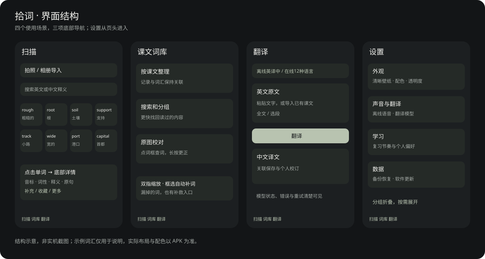

# 拾词

**从课文里拾起生词，让阅读继续。**

拍照识词 · 课文词库 · 中英翻译 · 本地学习资料

[下载 Android 安装包](https://github.com/mrhwrn0504/shici-updates/releases/latest) · [快速开始](QUICKSTART.md) · [功能详解](FEATURES.md) · [常见问题](FAQ.md) · [问题反馈](https://github.com/mrhwrn0504/shici-updates/issues/new)

拾词面向“读英语时，查词太频繁、查过又忘、扫描结果不好找”的场景：拍下课文，整理重点词；一屏浏览英文和一个中文意思，点词再看音标、词性与原句。课文、单词和译文保存在一起，之后可以继续阅读。

本仓库是**改进版的发布与使用指南仓库**。每个 Release 附有签名 APK、更新信息、校验摘要和对应源码压缩包；原始开源项目是 [zkwi/vocab-capture-android](https://github.com/zkwi/vocab-capture-android)。

## 先看界面结构

> 这是依据当前功能绘制的**结构示意图，不是实机截图**；示例词汇仅用于说明。实际字体、壁纸、配色和布局以安装包为准。未使用用户的私人壁纸作为公开展示素材。

## 一次阅读，少一点来回切换

| 场景 | 拾词怎么处理 |
| --- | --- |
| 课文里遇到很多生词 | 拍照或从相册导入，PaddleOCR 在设备上识别，保存课文记录 |
| 词太多，滚动难找 | 默认四列紧凑词卡，英文＋一个中文意思；支持中英文搜索、筛选和排序 |
| 只想先知道这个词的意思 | 点词打开底部详情，查看音标、词性、释义和课文原句；更多内容按需展开 |
| 扫错、漏词或选错重点 | 原图点词框查词；双指缩放、单指拖动；框选自动补词，或手动输入、更正、移出 |
| 想读懂一句或整篇 | 从课文导入翻译，支持选段和全文；在线中英互译、离线英译中 |
| 想以后继续读、继续记 | 词库先展示课文，保留来源关系；收藏、个人补充和复习设置可继续使用 |
| 希望界面安静一点 | 三项底部导航，设置分组折叠，暖色暗底默认；支持自选壁纸、透明度与跟随图片配色 |

## 下载与安装

- Android 8.0（API 26）及以上；当前提供 **arm64-v8a** 安装包。
- 从 [Releases](https://github.com/mrhwrn0504/shici-updates/releases/latest) 下载 `shici-…-arm64.apk`，按系统提示安装。
- 更新时覆盖安装，保留学习资料；不要为了升级先卸载。
- 安装过 0.10.0 及以上版本后，启动会定期检查新版；设置也可手动检查。更高版本才提示，可稍后或跳过。
- `SHA256.txt` 用于核对安装包完整性；对应源码在同一个 Release。

## 设计里的小细节

- **先简后详**：词卡只显示一条意思，点击后再展开详细资料。
- **以课文为单位**：从单词回到来源，避免孤立地堆积词条。
- **清晰壁纸，局部毛玻璃**：只在控件轮廓内绘制模糊背景，文字清晰；切页保留背景层，减少闪烁。
- **圆润但紧凑**：圆角上下栏、圆角词卡、合并原图工具；功能入口集中，避免大按钮占满屏幕。
- **照顾动效偏好**：轻量转场，设置中可减少动画。
- **有错能改**：保留原图、校对和个人释义；自动筛词不是不可修改的答案。
- **本机优先**：照片识别和基础查词无需将课文上传；联网翻译和词典扩展单独触发。

## 联网、离线与发音

| 能力 | 首次联网 | 后续离线 |
| --- | --- | --- |
| 拍照 OCR、基础词典、记录浏览 | 不需要下载 OCR 模型，随 APK 提供 | 支持 |
| 离线英译中 | 需下载 Google 中文翻译模型，英语模型已内置 | 模型就绪后支持 |
| 英语离线朗读 | 取决于手机 TTS 是否已有英语语音 | 有离线音色时支持 |
| 在线中英互译、联网词典补全、在线发音 | 需要网络，受服务可达性和额度限制 | 不支持 |
| 检查软件更新 | 需访问 GitHub 发布源 | 不支持 |

**翻译模型与朗读语音不是同一个东西。** 模型下载失败请先看 [下载排查](FAQ.md#离线翻译模型下载失败怎么办)，不要反复盲点重试。0.10.1 修复发行包翻译组件构造方法被压缩删除的问题，并提供“错误详情 → 复制信息”。手机网络无法访问模型服务器时，下载仍可能失败。

## 进一步了解

[功能与入口](FEATURES.md) · [完整上手步骤](QUICKSTART.md) · [常见问题](FAQ.md) · [隐私与联网说明](PRIVACY.md) · [构建与发布](BUILDING.md) · [贡献和反馈](CONTRIBUTING.md) · [版本记录](CHANGELOG.md)

## 反馈与项目边界

请在 [Issues](https://github.com/mrhwrn0504/shici-updates/issues/new) 描述版本、手机系统、操作步骤、预期和实际现象。离线翻译失败可附上应用内复制的错误详情。请删除私人课文内容与个人图片后再公开提交。

OCR、重点词筛选和翻译都可能出错；支持校对不代表能百分之百自动判断重点。当前没有云端账号同步、口语自动评分或 AI 自动批改；跟读录音已移除。发行编译、签名与资产检查不等于已通过所有手机的体验测试，实机问题持续由用户反馈。

## 开源与致谢

原项目：[zkwi/vocab-capture-android](https://github.com/zkwi/vocab-capture-android)，[MIT License](LICENSE)。识别使用 PaddleOCR Android SDK / ONNX Runtime / OpenCV；离线翻译使用 Google ML Kit；词典包含 ECDICT、NYIST-OS/WordList 等资料，对应来源与许可保留在源码和应用资源中。在线服务说明见 [PRIVACY.md](PRIVACY.md)。新图标由图像生成工具辅助设计，应用内保留 TRP 标识。

文档结构参考 [GitHub README 指南](https://docs.github.com/en/repositories/managing-your-repositorys-settings-and-features/customizing-your-repository/about-readmes)、[ReadYou](https://github.com/ReadYouApp/ReadYou) 与 [AnkiDroid](https://github.com/ankidroid/Anki-Android) 的入口组织方式；未复制其界面或宣传素材。
